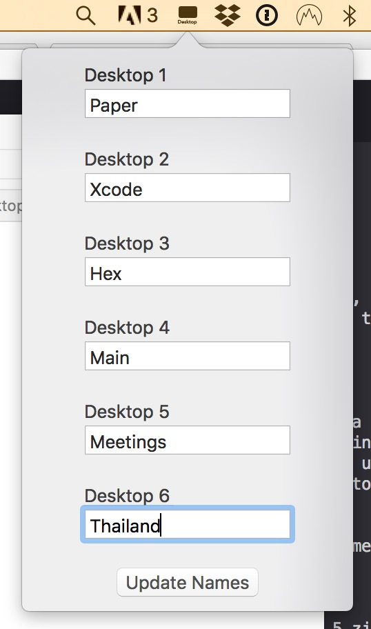

<h1 align="center">
  
  <p align="center">Spaces Renamer</p>
</h1>

Spaces Renamer is a combination of an application and SIMBL plugin to allow you to rename your spaces.

<p align="center">
  <br>
  <i>The compressed view after pressing F3</i>
</p>

<p align="center">
  <br>
  <i>The expanded view after hovering</i>
</p>

<p align="center">
  <br>
  <i>The interface for renaming the spaces</i>
</p>

Spaces Renamer supports multiple monitors, and highlights the current space in each monitor with an outline.  Here it is [in a video](https://vimeo.com/264878100) if you want to see it in action.

### The Problem
I want to be able to rename my spaces.  While TotalSpaces has this functionality, it's not free, and it has a bunch of other features that I'm not really interested in.

### The Solution
This is a SIMBL plugin and an application.  The SIMBL plugin handles renaming spaces from a saved plist.  The application adds an icon to the status bar that allows you to rename the spaces and update the plist.

## Installation

Pick the instructions that match your Mac (check Apple menu > About This Mac for the chip and macOS version):

| | Intel | Apple Silicon (M1-M6+) |
|---|---|---|
| **macOS 14.3 or earlier** | [Instructions](installation/intel-pre-14.4.md) | [Instructions](installation/apple-silicon-pre-14.4.md) |
| **macOS 14.4 to 15.5** | [Instructions](installation/macos-14.4-to-15.5.md) | [Instructions](installation/macos-14.4-to-15.5.md) |
| **macOS 15.6 to 26** | Unsupported | [Instructions](installation/apple-silicon-15.6-to-26.md) |

## Uninstall

You can trivially uninstall SpacesRenamer by using MacForge to delete the plugin and dragging the app to the Trash. If you want to fully remove MacForge and SpacesRenamer you can do the following:
1. Fully uninstall MacForge. Quit MacForgeHelper in 'Activity Monitor', and delete the application.
2. Delete the SpacesRenamer app by dragging it to the Trash.
3. Empty the Trash.
4. Run the following commands. This will delete all installed plugins.
```
sudo launchctl unload /Library/LaunchDaemons/com.macenhance.MacForge.Injector.plist
sudo rm -rf "/Library/Application Support/MacEnhance"
sudo rm /Library/LaunchDaemons/com.macenhance.MacForge.Injector.plist
sudo rm /Library/PrivilegedHelperTools/com.macenhance.MacForge.Injector
sudo rm -rf ~/Library/Containers/com.alexbeals.spacesrenamer
```

### Debugging Common Issues

**MacForge is automatically downgrading**  
If you are running into issues where MacForge is downgrading, try uninstall MacForge by deleting the app and emptying Trash, running the `purge.sh` file, restarting your computer, and then installing MacForge again. Make sure when you install you disable automatic upgrading and checks.

**I can't see the icon in the menu bar**  
Make sure the SpacesRenamer app is actually running (you can check it in Activity Monitor). If it is, it's likely that you just have a lot of icons. See [this comment](https://github.com/dado3212/spaces-renamer/issues/94#issuecomment-2126843231) for some recommendations on how to rearrange your icons to have it be visible.

--- 

Donations [are always appreciated](https://www.paypal.com/paypalme2/AlexBeals), but in no way expected.
